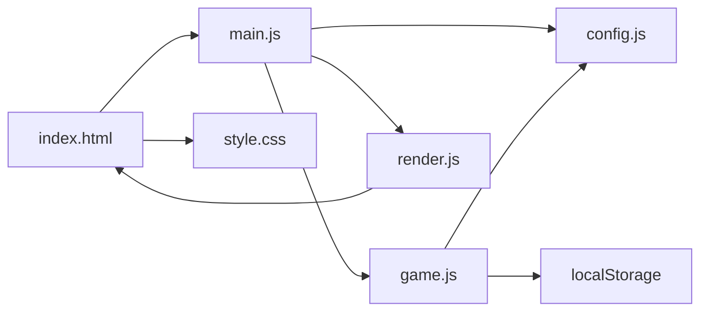
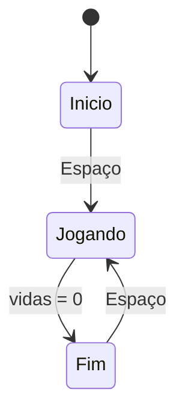

# Design: Chuva de Bugs

## Visão geral
O jogo será um único canvas centralizado em uma página simples, com três estados visuais bem definidos: início, partida ativa e fim de jogo. A lógica de regras ficará separada da renderização para facilitar testes manuais e manutenção. O fluxo principal usará um loop de animação com delta time em segundos e atualização por quadro. A maior parte das decisões de ajuste ficará em `CONFIG`, mantendo o restante do código livre de números mágicos.

## Decisões técnicas
| Decisão | Escolha | Por quê |
|---|---|---|
| Estrutura do jogo | Estado global com tela atual, player, itens, pontuação e recorde | Mantém a lógica simples e previsível para um jogo curto de 15 minutos |
| Entrada | Teclas de teclado com estado pressionado e evento de tecla | Permite mover o dev continuamente e detectar Espaço para iniciar e reiniciar |
| Renderização | Canvas 2D com emojis para player e itens | Conforma à stack fixa e reduz a necessidade de assets ou bibliotecas |
| Persistência | `localStorage` para salvar o recorde | Satisfaz o requisito de manter o melhor resultado no navegador sem backend |
| Organização | 6 arquivos principais no máximo | Mantém o código enxuto e compatível com o projeto escolar |

## Arquitetura


## Estrutura de arquivos
```text
index.html                 -> estrutura da página e o canvas principal
style.css                  -> layout, centralização e aparência da tela
src/main.js                -> bootstrap do jogo e loop principal
src/config.js              -> constantes do projeto e valores iniciais
src/game.js                -> regras, estado, colisões e recorde
src/render.js              -> desenho do mundo, HUD e telas de início/fim
```

## Componentes
### `index.html`: Estrutura do jogo
- **Responsabilidade:** montar a página com a área de jogo, o HUD e os textos de início e fim.
- **Estado:** sem estado próprio; apenas os elementos visuais da página.
- **Funções principais:** `initGame()`: prepara o canvas e conecta os elementos visuais do HTML ao módulo principal.
- **Atende:** 1.1, 5.1, 6.1

### `style.css`: Visual do projeto
- **Responsabilidade:** centralizar a área de jogo, definir fundo escuro, tipografia e layout das telas.
- **Estado:** estilos aplicados ao documento e ao canvas.
- **Funções principais:** `setupLayout()`: organiza o centro do jogo e as camadas de texto.
- **Atende:** 1.1, 5.1, 6.1

### `src/config.js`: Configuração central
- **Responsabilidade:** concentrar constantes de ajustes globais e valores iniciais do jogo.
- **Estado:** objeto `CONFIG` exportado com todos os valores ajustáveis.
- **Funções principais:** `createConfig()`: retorna o objeto com os valores padrões do jogo.
- **Atende:** 1.1, 2.1, 3.1, 4.1, 5.3, 6.2

### `src/main.js`: Inicialização e loop
- **Responsabilidade:** criar o estado inicial, registrar eventos de teclado, chamar o loop e trocar telas conforme o estado do jogo.
- **Estado:** `state`, `lastTime`, referências de canvas e contexto.
- **Funções principais:** `init()`: define o estado inicial; `gameLoop(timestamp)`: executa o update/draw em cada quadro; `handleKeydown(event)`: trata Espaço e setas/A-D.
- **Atende:** 1.1, 1.2, 6.3

### `src/game.js`: Lógica do jogo
- **Responsabilidade:** controlar movimento, spawn, aceleração, colisões, pontuação, vidas, fim de partida e recorde.
- **Estado:** player, itens, pontuação, vidas, estado atual, timer de spawn, recorde salvo em `localStorage`.
- **Funções principais:** `startGame()`: configura a partida; `update(dt)`: atualiza player, itens e colisões; `spawnItem()`: gera café ou bug em posição aleatória; `checkCollisions()`: detecta contato entre player e itens; `finishGame()`: encerra a partida e atualiza o recorde; `loadRecord()`: lê o melhor valor salvo.
- **Atende:** 1.2, 2.1, 2.2, 2.3, 2.4, 3.1, 3.2, 3.3, 3.4, 4.1, 4.2, 4.3, 4.4, 5.1, 5.2, 5.3, 5.4, 6.1, 6.2, 6.3, 6.4

### `src/render.js`: Desenho do mundo
- **Responsabilidade:** desenhar o fundo, HUD, itens, player e telas de início/fim.
- **Estado:** usa os valores do estado global, sem armazenar estado próprio prolongado.
- **Funções principais:** `drawBackground()`: desenha o fundo do editor; `drawHud()`: mostra pontuação e vidas; `drawPlayer()`: desenha o dev; `drawItems()`: desenha cafés e bugs; `drawStartScreen()`, `drawGameScreen()`, `drawEndScreen()`: exibem cada estágio do jogo.
- **Atende:** 1.1, 1.2, 5.1, 6.1, 6.2

## Configuração central (`CONFIG` em `src/config.js`)
| Constante | Valor inicial | Para que serve | Atende |
|---|---|---|---|
| `WORLD_WIDTH` | 800 | largura da área de jogo | 2.4, 3.1 |
| `WORLD_HEIGHT` | 600 | altura da área de jogo | 3.2, 3.3 |
| `PLAYER_SPEED` | 320 | velocidade do dev em unidades por segundo | 2.1, 2.2, 2.4 |
| `PLAYER_LIVES` | 3 | vidas iniciais | 5.3 |
| `ITEM_SPAWN_INTERVAL_BASE` | 1.1 | intervalo inicial de geração | 3.1, 3.4 |
| `ITEM_SPAWN_INTERVAL_MIN` | 0.4 | piso mínimo para velocidade de geração | 3.4 |
| `ITEM_FALL_SPEED_BASE` | 160 | velocidade base da queda | 3.2, 3.4 |
| `ITEM_FALL_SPEED_MAX` | 380 | limite da queda para aumentar dificuldade | 3.4 |
| `POINT_VALUE` | 1 | valor do café | 4.1, 5.2 |
| `LIFE_LOSS` | 1 | dano do bug | 4.2, 4.3 |
| `RECORD_KEY` | "chuvaDeBugsRecorde" | chave do armazenamento local | 6.2, 6.4 |
| `START_KEY` | "Space" | tecla de início e reinício | 1.2, 6.3 |

## Fluxo


Passo a passo do loop principal:
1. O programa verifica o estado atual: início, jogando ou fim.
2. Em início, espera a tecla Espaço para iniciar a partida e zerar pontuação, vidas e itens.
3. Em jogando, lê as teclas pressionadas e move o dev horizontalmente em função do delta time.
4. O sistema atualiza o timer de spawn e cria novos cafés/bugs em posições aleatórias do topo.
5. Cada item cai em velocidade proporcional ao tempo e é removido quando toca o fundo.
6. A lógica de colisão detecta contato com o dev: café soma 1 ponto; bug reduz 1 vida.
7. Se as vidas chegam a zero, a partida termina e o recorde é atualizado no navegador.
8. Em fim de jogo, o sistema exibe resultado e aguarda Espaço para reiniciar do zero.

## Propriedades de corretude
- Para qualquer quadro, o jogador fica dentro dos limites horizontais da área de jogo. (Valida: 2.4)
- Para qualquer item, SE a posição Y ultrapassar a borda inferior, ENTÃO o item é removido sem alterar pontuação nem vidas. (Valida: 3.3)
- Para qualquer colisão com café, a pontuação aumenta exatamente 1 ponto e o item desaparece. (Valida: 4.1, 5.2)
- Para qualquer colisão com bug, a vida diminui exatamente 1 unidade e o item desaparece. (Valida: 4.2, 4.3)
- Para qualquer situação em que a vida atual seja zero, o jogo entra no estado de fim e exibe a pontuação final. (Valida: 5.4, 6.1)
- Para qualquer reinício via Espaço, o jogo volta ao estado inicial com pontuação zerada e vidas iguais a 3. (Valida: 1.2, 5.3, 6.3)

## Casos limite
- O jogador pressiona esquerda e direita ao mesmo tempo: o dev deve parar ou manter a última direção válida, sem sair da tela.
- Vários itens aparecem na mesma coluna: a lógica de colisão deve processar cada item individualmente sem duplicar efeitos.
- O navegador recarrega a página com um recorde anterior: o valor salvo deve continuar visível na tela final.
- O jogador pressiona Espaço durante a partida: o jogo não deve reiniciar por acidente; a ação só será válida na tela inicial ou de fim de jogo.
